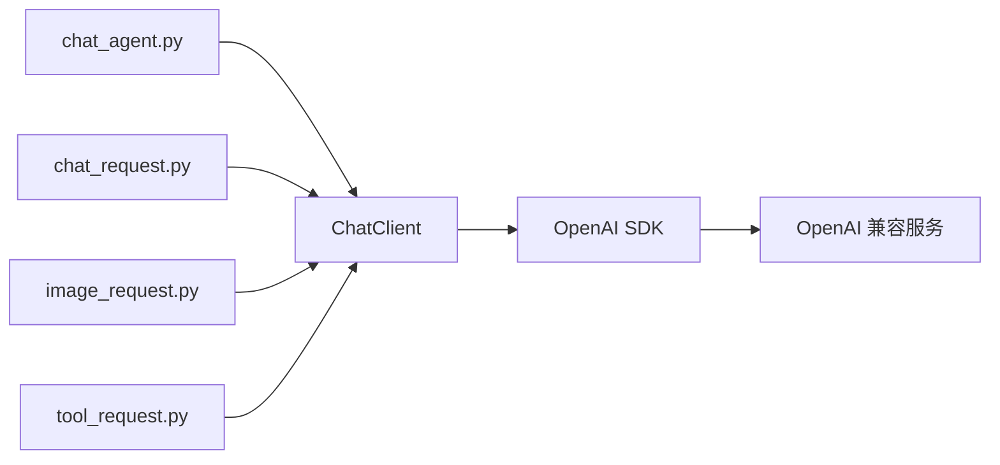

# OpenAI 兼容服务请求工具

使用 Python 3.10+ 和官方 OpenAI Python SDK，提供连续对话、单次文本请求和单次图文请求。默认连接局域网 Qwen，也可通过配置连接 OpenAI、DeepSeek 或兼容的中转站。依赖与运行环境由 uv 管理。

## 1. 仓库结构

```text
vllm_toys/
├── chat_agent.py        # 连续对话入口，保留上下文并流式输出
├── chat_request.py      # 单次文本请求入口
├── image_request.py     # 单次图文请求入口
├── tool_request.py      # 图文 agent 主动调用 YOLO 的入口
├── config.json          # 四个入口共用的服务配置
├── tool.json            # 工具调用配置，包含独立的 yolo 参数块
├── data/
│   ├── chat.txt         # 单次文本请求的提示词
│   ├── image.txt        # 普通图文请求的网格定位提示词，可用 --text 指定
│   ├── tool.txt         # 要求 agent 调用 YOLO 后描述图片的提示词
│   └── image.png        # 图文请求的 PNG 图片，需自行放入
├── util/
│   ├── __init__.py      # 导出 ChatClient
│   ├── client.py        # 通用客户端类，管理连接、请求和统计
│   ├── config.py        # 配置读取与校验
│   ├── cli.py           # 命令行、文件输入和终端输出
│   └── util.md          # 工具模块文档与 Mermaid 图
├── tool/
│   ├── __init__.py      # 导出 YOLO26s 工具和 OpenAI 工具定义
│   ├── yolo26.py        # 本地图片检测，延迟加载并复用权重
│   ├── config.py         # 工具配置读取与命令行覆盖
│   └── agent.py         # 模型工具调用、执行和结果回传循环
├── tests/
│   └── test_client.py   # 使用本地模拟服务进行测试
├── pyproject.toml       # 项目与依赖声明
├── uv.lock              # 依赖版本锁文件
├── README.md
├── .gitignore
└── LICENSE
```

## 2. 代码逻辑

四个入口负责准备消息、管理交互和展示结果，统一通过 `ChatClient` 调用服务。



| 入口 | 输入与处理 | 输出与会话行为 |
| --- | --- | --- |
| `chat_agent.py` | 从终端逐轮读取消息，附带历史上下文 | 流式输出；成功后保存本轮消息，历史仅保留在当前进程 |
| `chat_request.py` | 读取 `data/chat.txt`，构造一条用户消息 | 流式输出后退出，每次运行都是独立会话 |
| `image_request.py` | 读取提示词和 PNG，发送普通图文请求，不包含 tools | 流式输出后退出，要求模型支持图片输入及流式响应 |
| `tool_request.py` | 将原图、`data/tool.txt` 提示词和 YOLO 工具定义发送给模型；模型发起调用后才执行检测并回传结果 | 流式输出模型文本，结合工具结果描述图片；要求模型支持图片输入、流式响应和工具调用 |

`ChatClient` 读取配置，复用 SDK 连接，返回模型消息与耗时、token 用量；流式模式通过回调传出分片。客户端不保存对话历史，也不直接打印。SDK 负责底层 HTTP 和流式响应解析，`util/cli.py` 提供文件处理与终端输出辅助函数。

各模块的具体接口、配置项及服务切换示例见 [util/util.md](util/util.md)。

## 3. Usage

### 安装与同步环境

安装 [uv](https://docs.astral.sh/uv/getting-started/installation/) 后，在仓库根目录运行：

```bash
uv sync --locked
```

uv 根据 `uv.lock` 创建或同步 `.venv`。后续使用 `uv run` 执行，无需手动激活环境。

### 配置服务

编辑根目录的 `config.json`，当前默认配置为：

```json
{
  "base_url": "http://172.25.0.35:8000/v1",
  "model": "qwen-robot",
  "api_key": "",
  "api_key_env": "",
  "max_tokens": 4096,
  "timeout": 300,
  "stream_include_usage": true
}
```

`base_url` 填写 API 根地址，SDK 会追加 `/chat/completions`。`max_tokens` 控制每次生成的 token 上限，`timeout` 为网络等待超时秒数。

`config.json` 始终保留全部配置项，不需要的认证项填写空字符串 `""`。需要认证时，填写 `"api_key_env": "OPENAI_API_KEY"` 并设置对应环境变量，或通过 `api_key` 直接配置密钥。`api_key_env` 非空时优先，变量缺失或为空时会报错。中转站不支持流式用量参数时，可设置 `"stream_include_usage": false`。

### 连续对话

```bash
uv run chat_agent.py --config config.json
```

输入消息后回车即可发送。`/clear` 清空上下文，`/exit` 或 `/quit` 退出，也可使用 Ctrl+C 或 Ctrl+D。失败的请求不会加入上下文，退出后不保存历史。

每轮显示总耗时、首个文本分片耗时及输入、输出、总 token 数。输入 token 包含历史上下文；服务端未返回用量时会明确标注。回复达到 token 上限时会提示可能被截断，可增大 `max_tokens`；长会话超出上下文限制时可用 `/clear` 开始新会话。

### 单次文本请求

在 `data/chat.txt` 写入 UTF-8 提示词，然后运行：

```bash
uv run chat_request.py --config config.json --text data/chat.txt
```

文本文件缺失或内容为空时会报错。保存回复可使用：

```bash
uv run chat_request.py --config config.json --text data/chat.txt > reply.txt
```

文本和图文请求均逐片输出模型回复并立即刷新标准输出，请求结束后换行；耗时和 token 统计写入标准错误。

### 单次图文请求

`image_request.py` 已恢复原始普通图文流程，默认读取 `data/chat.txt` 和 `data/image.png`，不调用 YOLO、不发送工具定义。也可使用独立的网格定位提示词：

```bash
uv run image_request.py --config config.json --text data/image.txt --image data/image.png
```

### 单次图文工具请求

`tool_request.py` 保留视觉 agent 主动调用 YOLO 的流程，默认读取 `data/tool.txt`：

```bash
uv sync --locked --extra yolo
uv run --extra yolo tool_request.py --config config.json --tool-config tool.json --text data/tool.txt --image data/image.png
```

工具参数由仓库根目录的 `tool.json` 提供，`yolo` 是其中一个独立的工具参数块：

```json
{
  "max_tool_rounds": 5,
  "yolo": {
    "model": "yolo26s.pt",
    "device": "0",
    "confidence": 0.25
  }
}
```

`tool_request.py` 和 `chat_agent.py --enable-yolo` 共用这份配置。使用 `--tool-config` 可指定其他文件；`--yolo-model`、`--yolo-device`、`--confidence`、`--max-tool-rounds` 优先于 JSON 配置。默认使用 GPU 0，需要可用的 CUDA/PyTorch 环境；CPU 环境可设置 `"device": "cpu"` 或传入 `--yolo-device cpu`。权重名称或相对权重路径按当前工作目录解析。

流程为：原图、提示词及 `detect_objects` 工具定义发送给模型 → 流式接收并拼接 `tool_calls` 参数 → 完整调用结束后 agent 执行 YOLO26s → 将检测结果以 `role=tool` 回传 → 模型结合原图流式生成描述。所有轮次的回答正文逐片刷新到标准输出；服务端返回的推理内容逐片写入标准错误，并以 `[thinking]` 和 `[/thinking]` 标记。标准错误还显示 `[round_start]`、完整的 `[tool_call]` 参数、`[tool_result]`、`[finish_reason]` 及每轮用量统计。工具参数分片先在内部拼接，完整后显示并执行。脚本不会预先检测；只有模型实际发起工具调用才会运行 YOLO。提示词明确要求先调用工具，但不通过代码强制模型调用；模型没有返回工具调用时不会偷偷执行检测。

`data/tool.txt` 与 `data/image.txt` 使用相同的 block range 任务和 JSON 结构：每个物体输出覆盖的行范围 `block_range.rows`、列范围 `block_range.columns` 及逐行排列的 `block_ids`。范围包含起止行列，使用物体外接矩形覆盖的所有块；边缘恰好位于网格线上时，不额外计入相邻块。工具版使用可信 YOLO 检测框辅助计算，漏检或工具失败时仍结合原图定位，并在 `notes` 中说明依据和局限。工具失败时将错误回传给模型，供其重试或解释；空检测结果与检测失败分开处理。`confidence` 为模型提供建议阈值，模型省略该参数时检测器使用配置中的值；模型显式提交参数时以其提交值为准。`--max-tool-rounds` 限制模型请求次数，默认 5，包括最终回答。模型输出格式由提示词约束，脚本不强制校验 JSON。

图片需自行提供，服务端模型及部署配置须同时支持图片输入和 OpenAI 工具调用。推理输出兼容流式 `reasoning_content`、`reasoning` 和 `thinking` 字段；服务端没有返回推理内容时，客户端不会生成或补造。保存回答和运行过程可使用 `uv run --extra yolo tool_request.py > reply.txt 2> trace.log`。首次检测可能下载权重；离线使用时通过 `--yolo-model` 指定已准备好的本地权重。YOLO 日志写入标准错误，标准输出保留给模型回复。

### 自定义配置和数据路径

| 参数 | 支持的入口 | 默认路径 |
| --- | --- | --- |
| `--config` | 四个脚本 | `config.json` |
| `--text` | 文本、图文、图文工具请求 | 文本与普通图文：`data/chat.txt`；图文工具：`data/tool.txt` |
| `--image` | 图文、图文工具请求 | `data/image.png` |
| `--tool-config` | 图文工具请求、启用 YOLO 的连续对话 | `tool.json` |
| `-h` / `--help` | 四个脚本 | 显示命令行帮助 |

```bash
uv run chat_agent.py --config /path/to/config.json
uv run chat_request.py --config /path/to/config.json --text /path/to/chat.txt
uv run image_request.py --config /path/to/config.json --text /path/to/image.txt --image /path/to/image.png
uv run --extra yolo tool_request.py --config /path/to/config.json --tool-config /path/to/tool.json --text /path/to/tool.txt --image /path/to/image.png
```

默认文件路径以仓库根目录为基准；显式传入的相对路径以当前工作目录为基准。在其他目录使用 uv 启动时，可指定项目和脚本路径：

```bash
uv run --project /path/to/vllm_toys /path/to/vllm_toys/chat_agent.py --config /path/to/vllm_toys/config.json
```

### 让 agent 认知并调用 YOLO26s 工具

YOLO 已接入现有的 `chat_agent.py`，不是仅供手动执行的检测脚本。安装可选依赖并启用工具：

```bash
uv sync --locked --extra yolo
uv run --extra yolo chat_agent.py --config config.json --enable-yolo --tool-config tool.json
```

然后向 agent 输入，例如（替换为实际图片路径）：

```text
请调用 detect_objects 检测 /absolute/path/to/image.png，告诉我有哪些物体、各自的置信度和位置。
```

启用后，每次模型请求都会附带 `detect_objects` 的 OpenAI function tool 定义，包括用途、`image_path` 参数和可选的 `confidence`（默认 0.25）。模型返回 `tool_calls` 后，agent 执行 `tool/yolo26.py`，将 JSON 检测结果以 `role=tool` 和对应 `tool_call_id` 回传，再由模型生成回答；也支持一条回复中的多个工具调用。工具执行失败时回传错误供模型解释。模型自行决定是否调用，要求服务端模型及其部署配置支持 OpenAI 工具调用；不支持时仅在提示词里提到工具名称并不能替代此协议。

检测结果包含图片宽高及每个目标的类别 ID、类别名、置信度和像素坐标 `bbox_xyxy=[x1,y1,x2,y2]`；未检测到目标时 `detections` 为空列表。只接受 agent 所在机器上的本地图片，不接受 URL、目录或视频，不会输出标注图片。图片只在本地推理，模型收到的是检测结果，不是图片数据。工具可读取当前进程有权限访问的图片，请仅在可信交互环境中启用。

- 首次检测可能下载 `yolo26s.pt`；离线环境请提前准备权重并通过 `--yolo-model /path/to/yolo26s.pt` 指定。
- 默认使用 GPU 0，需要匹配的 PyTorch/CUDA 环境；可通过 `tool.json` 或 `--yolo-device cpu` 切换至 CPU。
- `tool_request.py` 使用流式工具请求；`chat_agent.py --enable-yolo` 仍使用非流式工具请求，普通聊天使用流式输出。
- `--max-tool-rounds` 限制每轮用户输入的模型请求次数（包括最终回答），默认 5；达到上限或请求失败时不保存本轮上下文。

其他 agent 也可直接复用工具定义和执行器：

```python
from tool import TOOL_SCHEMA, YOLO26Tool

# 将 TOOL_SCHEMA 放入模型请求的 tools 列表。
# 收到 detect_objects 调用后，将解析后的参数传给 detect，再回传结果。
detector = YOLO26Tool(model="yolo26s.pt", device="0")
result = detector.detect(image_path="data/image.png", confidence=0.25)
```

如需脱离 agent 单独调试检测（stdout 为 JSON，诊断信息在 stderr）：

```bash
uv run --extra yolo python tool/yolo26.py --image data/image.png --model yolo26s.pt --device 0 --confidence 0.25
```

### 在代码中使用客户端

```python
from util import ChatClient

with ChatClient.from_config("config.json") as client:
    message, stats = client.complete([
        {"role": "user", "content": "你好"},
    ])
    print(message["content"])
    print(stats["usage"])
```

### 依赖管理与测试

```bash
# 添加或移除依赖
uv add 包名
uv remove 包名

# 升级 OpenAI SDK 并同步环境
uv lock --upgrade-package openai
uv sync --locked

# 运行测试
uv run --locked python -m unittest discover -s tests -v
```

`pyproject.toml` 和 `uv.lock` 均应纳入版本管理，`.venv` 已被 Git 忽略。CI 中可使用 `uv run --locked ...`，在配置与锁文件不一致时直接报错。

测试使用本地模拟 HTTP 服务，覆盖请求格式、上下文、流式处理、用量统计、认证、错误处理、图片编码与连接生命周期，无需访问远端模型。
