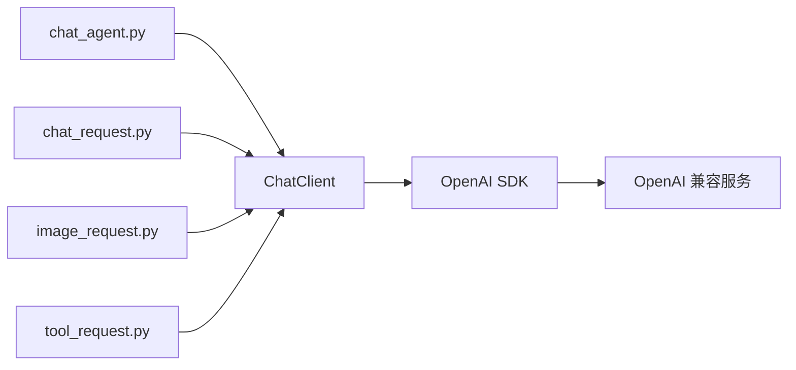

# OpenAI 兼容服务请求工具

使用 Python 3.10+ 和官方 OpenAI Python SDK，提供连续对话、单次文本请求和单次图文请求。默认连接局域网 Qwen，也可通过配置连接 OpenAI、DeepSeek 或兼容的中转站。依赖与运行环境由 uv 管理。

## 1. 仓库结构

```text
vllm_toys/
├── chat_agent.py        # 连续对话入口，保留上下文并流式输出
├── chat_request.py      # 单次文本请求入口
├── image_request.py     # 单次图文请求入口
├── tool_request.py      # 图文 agent 主动调用 YOLO 的入口
├── config.json          # 四个入口共用的服务配置
├── tool.json            # 工具调用配置，包含独立的 yolo 参数块
├── data/
│   ├── chat.txt         # 单次文本请求的提示词
│   ├── image.txt        # 普通图文请求的网格定位提示词，可用 --text 指定
│   ├── tool.txt         # 要求 agent 调用 YOLO 后描述图片的提示词
│   └── image.png        # 图文请求的 PNG 图片，需自行放入
├── util/
│   ├── __init__.py      # 导出 ChatClient
│   ├── client.py        # 通用客户端类，管理连接、请求和统计
│   ├── config.py        # 配置读取与校验
│   ├── cli.py           # 命令行、文件输入和终端输出
│   └── util.md          # 工具模块文档与 Mermaid 图
├── third_party/
│   └── mujoco_robot_cli/ # MuJoCo 机器人服务 Git submodule
├── tool/
│   ├── mujoco.py        # 机器人 HTTP 白名单适配，过滤仿真真值
│   ├── __init__.py      # 导出 YOLO 和机器人执行器及工具定义
│   ├── yolo26.py        # 本地图片检测，延迟加载并复用权重
│   ├── config.py         # 工具配置读取与命令行覆盖
│   └── agent.py         # 模型工具调用、执行和结果回传循环
├── tests/
│   └── test_client.py   # 使用本地模拟服务进行测试
├── pyproject.toml       # 项目与依赖声明
├── uv.lock              # 依赖版本锁文件
├── README.md
├── .gitignore
└── LICENSE
```

## 2. 代码逻辑

四个入口负责准备消息、管理交互和展示结果，统一通过 `ChatClient` 调用服务。



| 入口 | 输入与处理 | 输出与会话行为 |
| --- | --- | --- |
| `chat_agent.py` | 从终端逐轮读取消息，附带历史上下文 | 流式输出；成功后保存本轮消息，历史仅保留在当前进程 |
| `chat_request.py` | 读取 `data/chat.txt`，构造一条用户消息 | 流式输出后退出，每次运行都是独立会话 |
| `image_request.py` | 读取提示词和 PNG，发送普通图文请求，不包含 tools | 流式输出后退出，要求模型支持图片输入及流式响应 |
| `tool_request.py` | 将原图、`data/tool.txt` 提示词和 YOLO 工具定义发送给模型；模型发起调用后才执行检测并回传结果 | 流式输出模型文本，结合工具结果描述图片；要求模型支持图片输入、流式响应和工具调用 |

`ChatClient` 读取配置，复用 SDK 连接，返回模型消息与耗时、token 用量；流式模式通过回调传出分片。客户端不保存对话历史，也不直接打印。SDK 负责底层 HTTP 和流式响应解析，`util/cli.py` 提供文件处理与终端输出辅助函数。

各模块的具体接口、配置项及服务切换示例见 [util/util.md](util/util.md)。

## 3. Usage

### 安装与同步环境

安装 [uv](https://docs.astral.sh/uv/getting-started/installation/) 后，在仓库根目录运行：

```bash
uv sync --locked
```

uv 根据 `uv.lock` 创建或同步 `.venv`。后续使用 `uv run` 执行，无需手动激活环境。

### 配置服务

编辑根目录的 `config.json`，当前默认配置为：

```json
{
  "base_url": "http://172.25.0.35:8000/v1",
  "model": "qwen-robot",
  "api_key": "",
  "api_key_env": "",
  "max_tokens": 4096,
  "timeout": 300,
  "stream_include_usage": true
}
```

`base_url` 填写 API 根地址，SDK 会追加 `/chat/completions`。`max_tokens` 控制每次生成的 token 上限，`timeout` 为网络等待超时秒数。

可选的 `reasoning_effort` 和 `extra_body` 会透传给每轮模型请求（流式和非流式均支持）。服务端支持思考等级时，可在配置顶层添加 `"reasoning_effort": "low"`。对于支持 `enable_thinking` 的 Qwen/vLLM 模板，可改为添加：

```json
"extra_body": {
  "chat_template_kwargs": {"enable_thinking": false}
}
```

这会请求关闭 thinking；是否生效取决于实际模型和服务端模板，模型别名 `qwen-robot` 本身不能说明是否支持。建议按服务端支持情况选择一种配置，不支持的参数可能被拒绝或忽略。不配置时保留服务端默认行为。`max_tokens` 同时限制生成内容，不能单独限制思考，过小可能使工具参数或回答被截断。

抓取测试也读取这些参数，可通过 `MUJOCO_AGENT_CONFIG=/path/to/config.json` 指定单独配置；执行 agent 和视觉验收模型共用该配置。


`config.json` 始终保留全部配置项，不需要的认证项填写空字符串 `""`。需要认证时，填写 `"api_key_env": "OPENAI_API_KEY"` 并设置对应环境变量，或通过 `api_key` 直接配置密钥。`api_key_env` 非空时优先，变量缺失或为空时会报错。中转站不支持流式用量参数时，可设置 `"stream_include_usage": false`。

### 连续对话

```bash
uv run chat_agent.py --config config.json
```

输入消息后回车即可发送。`/clear` 清空上下文，`/exit` 或 `/quit` 退出，也可使用 Ctrl+C 或 Ctrl+D。失败的请求不会加入上下文，退出后不保存历史。

每轮显示总耗时、首个文本分片耗时及输入、输出、总 token 数。输入 token 包含历史上下文；服务端未返回用量时会明确标注。回复达到 token 上限时会提示可能被截断，可增大 `max_tokens`；长会话超出上下文限制时可用 `/clear` 开始新会话。

### 单次文本请求

在 `data/chat.txt` 写入 UTF-8 提示词，然后运行：

```bash
uv run chat_request.py --config config.json --text data/chat.txt
```

文本文件缺失或内容为空时会报错。保存回复可使用：

```bash
uv run chat_request.py --config config.json --text data/chat.txt > reply.txt
```

文本和图文请求均逐片输出模型回复并立即刷新标准输出，请求结束后换行；耗时和 token 统计写入标准错误。

### 单次图文请求

`image_request.py` 已恢复原始普通图文流程，默认读取 `data/chat.txt` 和 `data/image.png`，不调用 YOLO、不发送工具定义。也可使用独立的网格定位提示词：

```bash
uv run image_request.py --config config.json --text data/image.txt --image data/image.png
```

### 单次图文工具请求

`tool_request.py` 保留视觉 agent 主动调用 YOLO 的流程，默认读取 `data/tool.txt`：

```bash
uv sync --locked --extra yolo
uv run --extra yolo tool_request.py --config config.json --tool-config tool.json --text data/tool.txt --image data/image.png
```

工具参数由仓库根目录的 `tool.json` 提供，`yolo` 是其中一个独立的工具参数块：

```json
{
  "max_tool_rounds": 5,
  "yolo": {
    "model": "yolo26s.pt",
    "device": "0",
    "confidence": 0.25
  }
}
```

`tool_request.py` 和 `chat_agent.py --enable-yolo` 共用这份配置。使用 `--tool-config` 可指定其他文件；`--yolo-model`、`--yolo-device`、`--confidence`、`--max-tool-rounds` 优先于 JSON 配置。默认使用 GPU 0，需要可用的 CUDA/PyTorch 环境；CPU 环境可设置 `"device": "cpu"` 或传入 `--yolo-device cpu`。权重名称或相对权重路径按当前工作目录解析。

流程为：原图、提示词及 `detect_objects` 工具定义发送给模型 → 流式接收并拼接 `tool_calls` 参数 → 完整调用结束后 agent 执行 YOLO26s → 将检测结果以 `role=tool` 回传 → 模型结合原图流式生成描述。所有轮次的回答正文逐片刷新到标准输出；服务端返回的推理内容逐片写入标准错误，并以 `[thinking]` 和 `[/thinking]` 标记。标准错误还显示 `[round_start]`、完整的 `[tool_call]` 参数、`[tool_result]`、`[finish_reason]` 及每轮用量统计。工具参数分片先在内部拼接，完整后显示并执行。脚本不会预先检测；只有模型实际发起工具调用才会运行 YOLO。提示词明确要求先调用工具，但不通过代码强制模型调用；模型没有返回工具调用时不会偷偷执行检测。

`data/tool.txt` 与 `data/image.txt` 使用相同的 block range 任务和 JSON 结构：每个物体输出覆盖的行范围 `block_range.rows`、列范围 `block_range.columns` 及逐行排列的 `block_ids`。范围包含起止行列，使用物体外接矩形覆盖的所有块；边缘恰好位于网格线上时，不额外计入相邻块。工具版使用可信 YOLO 检测框辅助计算，漏检或工具失败时仍结合原图定位，并在 `notes` 中说明依据和局限。工具失败时将错误回传给模型，供其重试或解释；空检测结果与检测失败分开处理。`confidence` 为模型提供建议阈值，模型省略该参数时检测器使用配置中的值；模型显式提交参数时以其提交值为准。`--max-tool-rounds` 限制模型请求次数，默认 5，包括最终回答。模型输出格式由提示词约束，脚本不强制校验 JSON。

图片需自行提供，服务端模型及部署配置须同时支持图片输入和 OpenAI 工具调用。推理输出兼容流式 `reasoning_content`、`reasoning` 和 `thinking` 字段；服务端没有返回推理内容时，客户端不会生成或补造。保存回答和运行过程可使用 `uv run --extra yolo tool_request.py > reply.txt 2> trace.log`。首次检测可能下载权重；离线使用时通过 `--yolo-model` 指定已准备好的本地权重。YOLO 日志写入标准错误，标准输出保留给模型回复。

### 让 agent 调用 MuJoCo 机器人

机器人服务作为 Git submodule 固定在 `third_party/mujoco_robot_cli`。新克隆或切换版本后运行：

```bash
git submodule update --init --recursive
uv sync --locked
```

在单独的环境中按照 [子模块安装说明](third_party/mujoco_robot_cli/README.md) 安装并启动常驻仿真服务：

```bash
cd third_party/mujoco_robot_cli
# 在已安装该子项目及其依赖的环境中执行
mujoco_server --config configs/default.yaml
# 无窗口运行时追加 --headless
```

子项目依赖的 `hex_util_robot`、`hex_util_runtime`、`hex_util_urdf` 需要按其说明另行准备。当前项目只通过 HTTP 访问服务，不需要在聊天环境中安装 MuJoCo 或这些仿真依赖。

在本仓库根目录启动机器人 agent：

```bash
uv run chat_agent.py --enable-mujoco --tool-config tool.json
# 如需让 agent 同时使用 YOLO 检测相机图片：
uv run --extra yolo chat_agent.py --enable-mujoco --enable-yolo
```

`tool.json` 中的 `mujoco` 块配置 `server`（默认 `http://127.0.0.1:8000`）和 `timeout_s`（默认 20 秒）；可用 `--mujoco-server`、`--mujoco-timeout` 覆盖。与其他工具共用 `max_tool_rounds`。动作显式指定 `timeout_s` 时，HTTP 等待时间至少为动作超时加 5 秒。动作请求不会自动重试；超时后应先查询状态。位姿被 HTTP 422 拒绝后，在机械臂下一次成功执行控制前，不会再次向服务器提交相同的位姿（修改超时时间不算修改位姿）。工具会回传 HTTP 状态、错误码和本地生成的诊断建议；参数校验错误只额外返回涉及的参数名，不暴露服务器原始错误详情或仿真真值。

仅向模型注册并允许执行以下接口：

| 工具 | 用途 |
| --- | --- |
| `robot_get_joints` / `robot_set_joints` | 查询或控制六个关节，角度单位弧度 |
| `robot_get_pose` / `robot_set_pose` | 查询或控制末端绝对位姿，统一使用 `base_link` 坐标，位置单位米，四元数顺序 wxyz |
| `robot_move_delta` | 在指令开始时的 TCP 当前坐标系中执行平移与 RPY 角度增量；平移米、角度弧度，支持连续自身坐标系操控 |
| `robot_get_gripper` / `robot_set_gripper` | 查询或控制夹爪；action 与 opening_ratio 二选一 |
| `robot_camera_image` | 获取 end 或 left_rear 相机的 RGB 或深度 PNG；默认 rgb，depth 返回原始毫米数据、灰度预览及像素深度 |
| `robot_pixel_to_base` | 将指定相机的像素和深度转换为 `base_link` 下 XYZ，可选指定 TCP 位姿，省略时使用当前位姿 |

例如输入：`请先查看 left_rear 相机，再查询机械臂位姿，描述当前看到的场景。` 相机观察需要服务端模型支持视觉输入。`type="rgb"` 返回的图片路径可供同一进程中的 `detect_objects` 使用；深度图用于距离观测，不应交给 RGB 检测器。临时图片在 agent 退出时清理。

深度调用示例（工具名均为 `robot_camera_image`）：

```json
{"camera": "end", "type": "depth", "pixels": [[112, 112], [120, 130]]}
```

`type` 可选 `rgb` 或 `depth`，省略时为 `rgb`。`pixels` 仅用于深度，指定最多 64 个整数像素 `[u,v]`，原点在左上角，u 向右、v 向下；省略时返回中心像素。工具保存未修改的单通道 uint16 PNG 到 `image_path`，单位毫米，并在 `samples` 中返回每个像素的 `depth_mm`、`depth_m` 和 `valid`。0 和 65535（饱和值）按无效处理，样本距离为 null；原始 PNG 保留原值。错误类型、非整数或越界像素会返回工具错误。

`robot_pixel_to_base` 必填 `camera`、`pixel:[u,v]` 和 `depth_m`，例如 `{"camera":"end","pixel":[112,112],"depth_m":0.5}`。默认由服务端提供相机标定，`end` 使用当前 TCP 位姿计算；`left_rear` 是固定相机，其结果不随机械臂运动变化。可同时提供 `tcp_position_base` 和 `tcp_quaternion_base` 指定计算所用的 TCP 位姿，位置单位米，四元数顺序 wxyz。

`robot_camera_image` 返回值仍包含图像采集时的 `tcp_position_base`、`tcp_quaternion_base`、`camera_position_tcp`、`camera_rotation_tcp` 和 `intrinsics`。需要按特定深度帧精确反投影时，先请求 `type="depth"` 并用 `pixels:[[u,v]]` 获取样本，再将该样本的 `depth_m` 与同一次返回的完整采集元数据传给 `robot_pixel_to_base`；此模式不读取当前位姿或服务端最新图像。相机内外参必须全套传入，并同时提供采集时 TCP 位姿。默认当前位姿模式不保证与更早采集的深度帧同步。

模型收到的是 `preview_path` 对应的 8 位灰度预览及数值说明：黑色为无效，灰度从近到远递增，按本帧有效范围线性缩放；`preview.near_mm/far_mm` 给出范围，整帧有效深度相同时使用灰度 128。精确距离使用 `samples`，不能从跨帧灰度变化直接推断位移。返回值还包含图像尺寸和服务提供的 epoch、step、采样时间；RGB 和深度是独立请求，不保证同一帧。深度沿相机光轴，不是世界 Z 高度，也不会自动转换为世界三维坐标；`valid` 只表示数值未无效/饱和，背景仍可能返回远裁剪面距离，不代表命中物块或目标。

`reset`、全部 `object` 接口（包括位置查询、移动和 in-target 判定）、完整仿真配置查询均不开放。执行层使用固定路由白名单并拒绝额外参数，模型不能传入 URL、路径或任意 CLI 命令。机械臂和夹爪控制响应中附带的完整仿真快照也经过字段白名单过滤，只返回机器人状态和动作结果，剔除 object 真值及目标区信息；失败响应同样过滤。该限制作用于本项目的 agent 工具层，原仿真服务的管理接口仍由子模块提供。

所有机械臂和物块 pose 均以 `base_link` 为基准；默认场景的 base 在 world Z=0.25 m，旧 world 目标迁移到 base 时 Z 减 0.25 m。`robot_move_delta` 使用指令开始时的 TCP 坐标系：`delta_position=[dx,dy,dz]` 沿 TCP 局部轴，`delta_rpy=[roll,pitch,yaw]` 为右手系局部旋转（弧度）。

其他 agent 可以复用相同适配器：

```python
from tool import MUJOCO_TOOL_SCHEMAS, MujocoRobotTool

robot = MujocoRobotTool(server="http://127.0.0.1:8000")
try:
    # 将 MUJOCO_TOOL_SCHEMAS 传给模型；将模型的工具名和 JSON 参数交给 execute。
    result = robot.execute("robot_get_pose", {"frame": "base"})
finally:
    robot.close()
```

### 真实 agent 夹块放入 target 集成测试

[tests/test_mujoco_agent_e2e.py](tests/test_mujoco_agent_e2e.py) 调用真实模型和运行中的仿真服务，让 agent 自主观察、抓取、抬升、运输、释放并撤离。测试不会执行 reset 或设置物块，运行前需准备一个物块位于目标区外的场景；执行后保留现场。

```bash
MUJOCO_AGENT_E2E=1 uv run --locked python -m unittest discover \
  -s tests -p test_mujoco_agent_e2e.py -v
```

可选环境变量：

| 变量 | 默认值 | 用途 |
| --- | --- | --- |
| `MUJOCO_SERVER` | `http://127.0.0.1:8000` | 仿真 HTTP 服务地址 |
| `MUJOCO_AGENT_CONFIG` | 仓库 `config.json` | 真实模型配置，需支持视觉与工具调用 |
| `MUJOCO_AGENT_MAX_ROUNDS` | `40` | agent 模型请求轮数上限 |

测试先采集初始观测，然后通过服务的末端控制接口移动到用户指定的准备位姿：base_link 位置 `[0.4, 0.0, 0.182]`，wxyz 四元数 `[0.9238795325112867, 0.0, 0.3826834323650898, 0.0]`（对应旧 world 位置 `[0.4, 0.0, 0.432]`）。控制必须返回 `reached`，并通过传感器确认位置误差不超过 2 cm、朝向误差不超过 0.1 rad，否则停止，不调用 agent。

agent 可自行选择 `robot_set_pose` 绝对位姿控制或 `robot_move_delta` TCP 局部增量控制，测试不开放关节控制工具。提示词提供确认红块、靠近并微调、闭爪抬起、移到目标附近并微调、松爪撤离的五步流程。绝对位姿使用 `base_link` 坐标；增量方向相对指令开始时 TCP 坐标系。像素点需从 depth 帧取得深度样本，调用 `robot_pixel_to_base` 时必须指定对应相机；可省略 TCP 位姿使用当前姿态，或显式提供位姿。需要按同一帧精确反投影时，传入该帧完整的 TCP pose、相机外参和内参。

agent 仍可查询关节、末端位姿、夹爪状态和两路相机的 RGB/深度，并控制夹爪；不启用 YOLO 或任意文件/命令访问。每个初始、基准和最终观测阶段均采集两路相机的 RGB 与深度。模型通过“观察 → 小幅位置偏移 → 再观察”逐步靠近、对齐、抓取和放置，无需先求出物块或目标的精确世界坐标；准备位姿仅是机器人控制基准。方向不明时基于当前实测位姿做 1～2 cm 单轴试探，接近接触区域时缩小至毫米级，每次观察后再调整。提示词保留坐标约定和偏移换算，并要求在抬升、运输、释放撤离后主动拍照。

完成后，测试再获取两组间隔至少一秒的传感器观测，并以独立模型请求进行视觉验收。验收只接收过滤后的工具记录、传感器反馈和相机图像，不接收执行 agent 的成功声明；初始物块在目标外、实际夹起、夹持运输、释放到目标内、稳定且夹爪撤离这五项必须全部通过。关键证据不足时判失败。该验收依赖视觉模型判断，存在识别误差，不等同于仿真真值测量；测试与验收均不访问 object 或 in-target 接口。

终端会流式显示 agent 与验收模型的思考、回答，逐次打印工具参数、偏移展开后的目标位姿、完整过滤后的传感器返回、实际 TCP 位移、相对基准偏移、耗时与每轮 token 统计，并输出逐项验收结果和最终报告。模型服务未提供思考内容时不会补造。

每次运行会打印 `/tmp/mujoco-agent-e2e-*` 证据目录，保存 RGB、原始 uint16 深度及深度预览 PNG（文件名区分相机和类型）、`observations.json`、`events.jsonl`、`events.json`、`model-stream.txt` 和 `report.json`；agent 正常结束后还保存去掉 base64 图片的 `conversation.json`。观测、模型流式文本和 `events.jsonl` 在运行过程中持续写入，完整模型消息也写入事件记录；失败或手动中断时保留已获得的证据与错误报告。连续三次机械臂控制失败时会停止测试并保留现场，查询状态不会清除此失败计数；成功执行机械臂控制后计数重新开始。真实测试默认跳过，显式设置 `MUJOCO_AGENT_E2E=1` 才会调用模型并控制机器人。普通单元测试另有模拟验收用例，验证通过/失败分支、真值过滤和验收输入隔离；模拟通过不代表真实抓取成功。

### 自定义配置和数据路径

| 参数 | 支持的入口 | 默认路径 |
| --- | --- | --- |
| `--config` | 四个脚本 | `config.json` |
| `--text` | 文本、图文、图文工具请求 | 文本与普通图文：`data/chat.txt`；图文工具：`data/tool.txt` |
| `--image` | 图文、图文工具请求 | `data/image.png` |
| `--tool-config` | 图文工具请求、启用 YOLO 的连续对话 | `tool.json` |
| `-h` / `--help` | 四个脚本 | 显示命令行帮助 |

```bash
uv run chat_agent.py --config /path/to/config.json
uv run chat_request.py --config /path/to/config.json --text /path/to/chat.txt
uv run image_request.py --config /path/to/config.json --text /path/to/image.txt --image /path/to/image.png
uv run --extra yolo tool_request.py --config /path/to/config.json --tool-config /path/to/tool.json --text /path/to/tool.txt --image /path/to/image.png
```

默认文件路径以仓库根目录为基准；显式传入的相对路径以当前工作目录为基准。在其他目录使用 uv 启动时，可指定项目和脚本路径：

```bash
uv run --project /path/to/vllm_toys /path/to/vllm_toys/chat_agent.py --config /path/to/vllm_toys/config.json
```

### 让 agent 认知并调用 YOLO26s 工具

YOLO 已接入现有的 `chat_agent.py`，不是仅供手动执行的检测脚本。安装可选依赖并启用工具：

```bash
uv sync --locked --extra yolo
uv run --extra yolo chat_agent.py --config config.json --enable-yolo --tool-config tool.json
```

然后向 agent 输入，例如（替换为实际图片路径）：

```text
请调用 detect_objects 检测 /absolute/path/to/image.png，告诉我有哪些物体、各自的置信度和位置。
```

启用后，每次模型请求都会附带 `detect_objects` 的 OpenAI function tool 定义，包括用途、`image_path` 参数和可选的 `confidence`（默认 0.25）。模型返回 `tool_calls` 后，agent 执行 `tool/yolo26.py`，将 JSON 检测结果以 `role=tool` 和对应 `tool_call_id` 回传，再由模型生成回答；也支持一条回复中的多个工具调用。工具执行失败时回传错误供模型解释。模型自行决定是否调用，要求服务端模型及其部署配置支持 OpenAI 工具调用；不支持时仅在提示词里提到工具名称并不能替代此协议。

检测结果包含图片宽高及每个目标的类别 ID、类别名、置信度和像素坐标 `bbox_xyxy=[x1,y1,x2,y2]`；未检测到目标时 `detections` 为空列表。只接受 agent 所在机器上的本地图片，不接受 URL、目录或视频，不会输出标注图片。图片只在本地推理，模型收到的是检测结果，不是图片数据。工具可读取当前进程有权限访问的图片，请仅在可信交互环境中启用。

- 首次检测可能下载 `yolo26s.pt`；离线环境请提前准备权重并通过 `--yolo-model /path/to/yolo26s.pt` 指定。
- 默认使用 GPU 0，需要匹配的 PyTorch/CUDA 环境；可通过 `tool.json` 或 `--yolo-device cpu` 切换至 CPU。
- `tool_request.py` 使用流式工具请求；`chat_agent.py --enable-yolo` 仍使用非流式工具请求，普通聊天使用流式输出。
- `--max-tool-rounds` 限制每轮用户输入的模型请求次数（包括最终回答），默认 5；达到上限或请求失败时不保存本轮上下文。

其他 agent 也可直接复用工具定义和执行器：

```python
from tool import TOOL_SCHEMA, YOLO26Tool

# 将 TOOL_SCHEMA 放入模型请求的 tools 列表。
# 收到 detect_objects 调用后，将解析后的参数传给 detect，再回传结果。
detector = YOLO26Tool(model="yolo26s.pt", device="0")
result = detector.detect(image_path="data/image.png", confidence=0.25)
```

如需脱离 agent 单独调试检测（stdout 为 JSON，诊断信息在 stderr）：

```bash
uv run --extra yolo python tool/yolo26.py --image data/image.png --model yolo26s.pt --device 0 --confidence 0.25
```

### 在代码中使用客户端

```python
from util import ChatClient

with ChatClient.from_config("config.json") as client:
    message, stats = client.complete([
        {"role": "user", "content": "你好"},
    ])
    print(message["content"])
    print(stats["usage"])
```

### 依赖管理与测试

```bash
# 添加或移除依赖
uv add 包名
uv remove 包名

# 升级 OpenAI SDK 并同步环境
uv lock --upgrade-package openai
uv sync --locked

# 运行测试
uv run --locked python -m unittest discover -s tests -v
```

`pyproject.toml` 和 `uv.lock` 均应纳入版本管理，`.venv` 已被 Git 忽略。CI 中可使用 `uv run --locked ...`，在配置与锁文件不一致时直接报错。

测试使用本地模拟 HTTP 服务，覆盖请求格式、上下文、流式处理、用量统计、认证、错误处理、图片编码与连接生命周期，无需访问远端模型。
