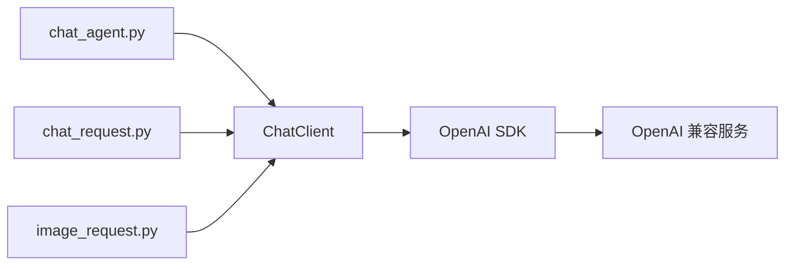

# OpenAI 兼容服务请求工具

使用 Python 3.10+ 和官方 OpenAI Python SDK，提供连续对话、单次文本请求和单次图文请求。默认连接局域网 Qwen，也可通过配置连接 OpenAI、DeepSeek 或兼容的中转站。依赖与运行环境由 uv 管理。

## 1. 仓库结构

```text
vllm_toys/
├── chat_agent.py        # 连续对话入口，保留上下文并流式输出
├── chat_request.py      # 单次文本请求入口
├── image_request.py     # 单次图文请求入口
├── config.json          # 三个入口共用的服务配置
├── data/
│   ├── chat.txt         # 单次请求的提示词
│   └── image.png        # 图文请求的 PNG 图片，需自行放入
├── util/
│   ├── __init__.py      # 导出 ChatClient
│   ├── client.py        # 通用客户端类，管理连接、请求和统计
│   ├── config.py        # 配置读取与校验
│   ├── cli.py           # 命令行、文件输入和终端输出
│   └── util.md          # 工具模块文档与 Mermaid 图
├── tests/
│   └── test_client.py   # 使用本地模拟服务进行测试
├── pyproject.toml       # 项目与依赖声明
├── uv.lock              # 依赖版本锁文件
├── README.md
├── .gitignore
└── LICENSE
```

## 2. 代码逻辑

三个入口负责准备消息、管理交互和展示结果，统一通过 `ChatClient` 调用服务。



| 入口 | 输入与处理 | 输出与会话行为 |
| --- | --- | --- |
| `chat_agent.py` | 从终端逐轮读取消息，附带历史上下文 | 流式输出；成功后保存本轮消息，历史仅保留在当前进程 |
| `chat_request.py` | 读取 `data/chat.txt`，构造一条用户消息 | 收到完整回复后输出并退出，每次运行都是独立会话 |
| `image_request.py` | 读取提示词和 PNG，将图片编码为 base64，与文本组成一条用户消息 | 收到完整回复后输出并退出，要求模型支持图片输入 |

`ChatClient` 读取配置，复用 SDK 连接，返回模型消息与耗时、token 用量；流式模式通过回调传出分片。客户端不保存对话历史，也不直接打印。SDK 负责底层 HTTP 和流式响应解析，`util/cli.py` 提供文件处理与终端输出辅助函数。

各模块的具体接口、配置项及服务切换示例见 [util/util.md](util/util.md)。

## 3. Usage

### 安装与同步环境

安装 [uv](https://docs.astral.sh/uv/getting-started/installation/) 后，在仓库根目录运行：

```bash
uv sync --locked
```

uv 根据 `uv.lock` 创建或同步 `.venv`。后续使用 `uv run` 执行，无需手动激活环境。

### 配置服务

编辑根目录的 `config.json`，当前默认配置为：

```json
{
  "base_url": "http://172.25.0.35:8000/v1",
  "model": "qwen-robot",
  "api_key": "",
  "api_key_env": "",
  "max_tokens": 4096,
  "timeout": 300,
  "stream_include_usage": true
}
```

`base_url` 填写 API 根地址，SDK 会追加 `/chat/completions`。`max_tokens` 控制每次生成的 token 上限，`timeout` 为网络等待超时秒数。

`config.json` 始终保留全部配置项，不需要的认证项填写空字符串 `""`。需要认证时，填写 `"api_key_env": "OPENAI_API_KEY"` 并设置对应环境变量，或通过 `api_key` 直接配置密钥。`api_key_env` 非空时优先，变量缺失或为空时会报错。中转站不支持流式用量参数时，可设置 `"stream_include_usage": false`。

### 连续对话

```bash
uv run chat_agent.py
```

输入消息后回车即可发送。`/clear` 清空上下文，`/exit` 或 `/quit` 退出，也可使用 Ctrl+C 或 Ctrl+D。失败的请求不会加入上下文，退出后不保存历史。

每轮显示总耗时、首个文本分片耗时及输入、输出、总 token 数。输入 token 包含历史上下文；服务端未返回用量时会明确标注。回复达到 token 上限时会提示可能被截断，可增大 `max_tokens`；长会话超出上下文限制时可用 `/clear` 开始新会话。

### 单次文本请求

在 `data/chat.txt` 写入 UTF-8 提示词，然后运行：

```bash
uv run chat_request.py
```

文本文件缺失或内容为空时会报错。保存回复可使用：

```bash
uv run chat_request.py > reply.txt
```

模型回复写入标准输出，耗时和 token 统计写入标准错误。

### 单次图文请求

将 PNG 图片放入 `data/image.png`，在 `data/chat.txt` 写入问题，然后运行：

```bash
uv run image_request.py
```

图片需自行提供，服务端模型须支持图片输入。

### 自定义配置和数据路径

| 参数 | 支持的入口 | 默认路径 |
| --- | --- | --- |
| `--config` | 三个脚本 | `config.json` |
| `--text` | 文本、图文请求 | `data/chat.txt` |
| `--image` | 图文请求 | `data/image.png` |
| `-h` / `--help` | 三个脚本 | 显示命令行帮助 |

```bash
uv run chat_agent.py --config /path/to/config.json
uv run chat_request.py --text /path/to/chat.txt
uv run image_request.py --text /path/to/chat.txt --image /path/to/image.png
```

默认文件路径以仓库根目录为基准；显式传入的相对路径以当前工作目录为基准。在其他目录使用 uv 启动时，可指定项目和脚本路径：

```bash
uv run --project /path/to/vllm_toys /path/to/vllm_toys/chat_agent.py
```

### 在代码中使用客户端

```python
from util import ChatClient

with ChatClient.from_config("config.json") as client:
    message, stats = client.complete([
        {"role": "user", "content": "你好"},
    ])
    print(message["content"])
    print(stats["usage"])
```

### 依赖管理与测试

```bash
# 添加或移除依赖
uv add 包名
uv remove 包名

# 升级 OpenAI SDK 并同步环境
uv lock --upgrade-package openai
uv sync --locked

# 运行测试
uv run --locked python -m unittest discover -s tests -v
```

`pyproject.toml` 和 `uv.lock` 均应纳入版本管理，`.venv` 已被 Git 忽略。CI 中可使用 `uv run --locked ...`，在配置与锁文件不一致时直接报错。

测试使用本地模拟 HTTP 服务，覆盖请求格式、上下文、流式处理、用量统计、认证、错误处理、图片编码与连接生命周期，无需访问远端模型。
