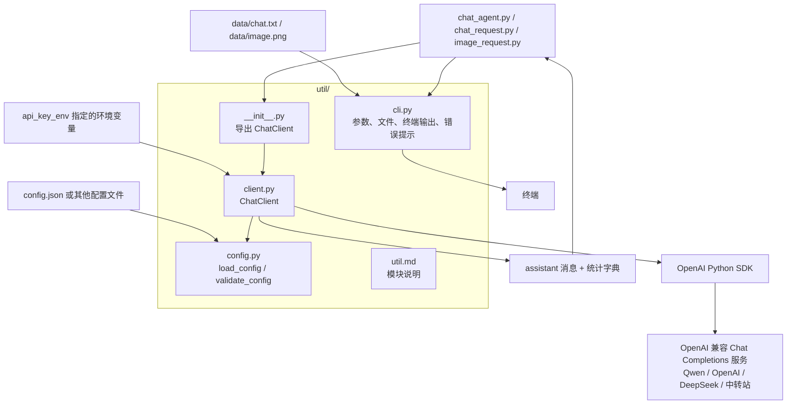
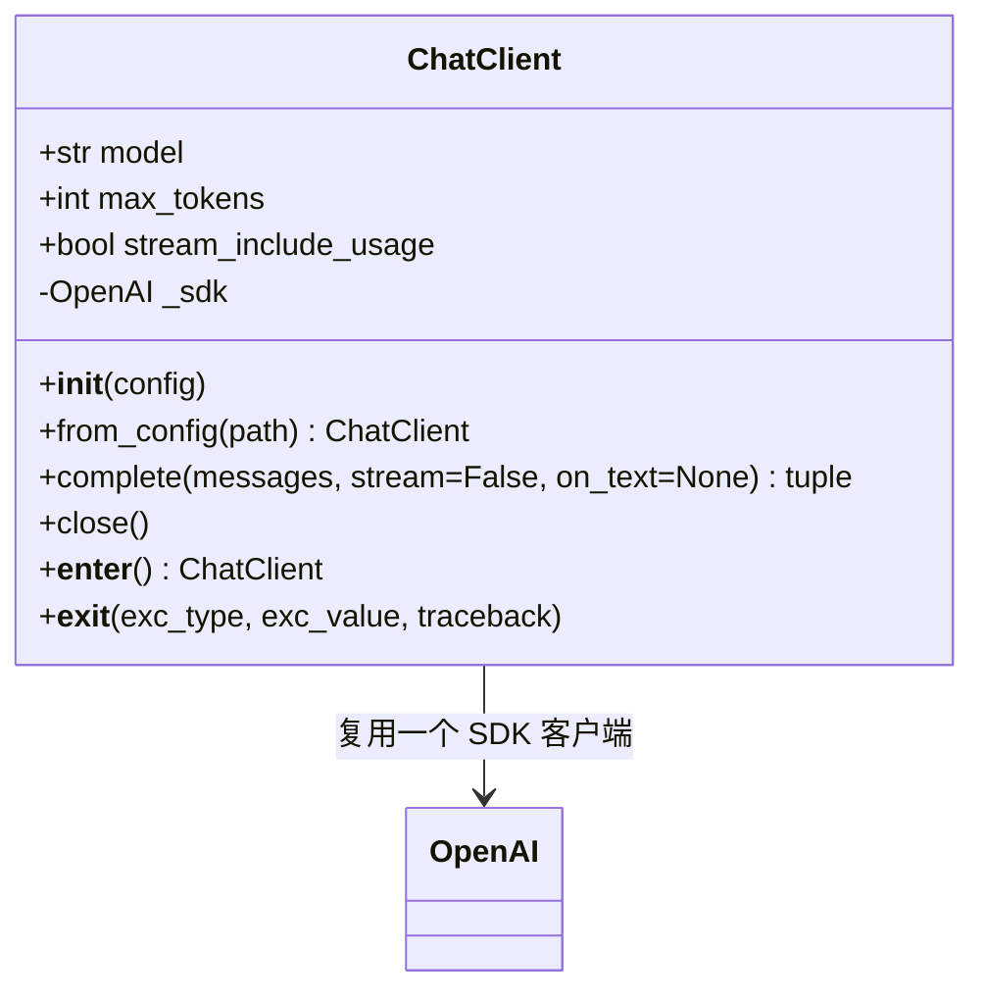

# util 公共工具

`util/` 为三个命令行入口提供通用的 OpenAI 兼容客户端和辅助工具。服务地址、模型名称和认证均来自配置，客户端没有绑定 Qwen。当前使用 Chat Completions 协议，可用于支持该协议的 Qwen 服务、OpenAI、DeepSeek 和中转站；各服务支持的模型、图片输入和请求参数仍需以服务端为准。

## 文件职责

| 文件 | 职责 |
| --- | --- |
| `__init__.py` | 导出 `ChatClient`，供外部使用 `from util import ChatClient` |
| `client.py` | 定义 `ChatClient`，管理 SDK 连接、普通和流式请求、回复汇总、计时及 token 用量 |
| `config.py` | `load_config(path)` 读取 JSON；`validate_config(config)` 校验配置并返回副本 |
| `cli.py` | 命令行参数、仓库默认路径、提示词读取、PNG 编码、终端输出及错误提示 |
| `util.md` | 模块职责、类接口、配置及调用关系说明 |

## 模块关系



## ChatClient 类



`ChatClient(config)` 接受配置字典，`ChatClient.from_config(path)` 从 JSON 文件创建实例。推荐使用 `with`，以便在正常退出和异常时都关闭底层连接；也可以显式调用 `close()`。同一个实例可连续发起多次请求，复用 SDK 的连接池。

```python
from util import ChatClient

with ChatClient.from_config("config.json") as client:
    message, stats = client.complete([
        {"role": "user", "content": "你好"},
    ])
    print(message["content"])
    print(stats["usage"])
```

`complete(messages, stream=False, on_text=None)` 接受 OpenAI 格式的消息列表，返回 `(message, stats)`：

| 返回值 | 内容 |
| --- | --- |
| `message` | 包含 `role`、`content` 的 assistant 消息；服务端返回独立推理内容时保留 `reasoning_content` |
| `stats.elapsed` | 请求开始到回复读取完成的秒数 |
| `stats.first_text` | 流式模式首个非空文本或推理分片的耗时；非流式模式为 `None` |
| `stats.usage` | 服务端 token 用量字典；未返回时为 `None` |
| `stats.finish_reason` | 服务端完成原因，如 `stop` 或 `length` |

`stats` 是字典，表中的字段通过 `stats["elapsed"]` 等方式访问。`stream=True` 时按顺序调用 `on_text(chunk)`，同时汇总完整回复；回调收到文本，也可能收到服务端单独返回的推理内容。客户端不直接打印，也不保存对话历史。调用方决定展示方式，以及是否将成功回复加入下一轮请求。

流式响应缺少 `finish_reason` 时抛出 `ValueError`。SDK 的 API 和网络异常原样向上传递，由 `cli.py` 的 `run()` 或交互程序处理。自动重试关闭，避免一次调用包含多次隐式请求。

## 配置与服务切换

当前根目录配置仍指向局域网 Qwen，无需改动即可使用。

| 配置项 | 默认值 | 说明 |
| --- | --- | --- |
| `base_url` | 必填 | API 根地址，SDK 自动追加 `/chat/completions` |
| `model` | 必填 | 服务端识别的模型名 |
| `max_tokens` | `128` | 单次生成 token 上限 |
| `timeout` | `120` | 网络等待超时，单位秒 |
| `api_key` | `not-needed` 占位值 | 直接配置认证密钥；不需要认证的服务可省略 |
| `api_key_env` | 未设置 | 从指定环境变量读取密钥；设置后优先于 `api_key`，变量缺失或为空则报错 |
| `stream_include_usage` | `true` | 是否向流式请求加入 `stream_options.include_usage`；中转站不支持时可设为 `false` |

例如，新建 `config.deepseek.json`：

```json
{
  "base_url": "https://api.deepseek.com",
  "model": "deepseek-chat",
  "api_key_env": "DEEPSEEK_API_KEY",
  "max_tokens": 1024,
  "timeout": 120,
  "stream_include_usage": true
}
```

```bash
export DEEPSEEK_API_KEY="你的密钥"
uv run chat_agent.py --config config.deepseek.json
```

其他服务也使用相同结构：

| 服务 | `base_url` 示例 | `model` 示例 | 认证 |
| --- | --- | --- | --- |
| 当前 Qwen | `http://172.25.0.35:8000/v1` | `qwen-robot` | 当前服务无需配置 |
| OpenAI | `https://api.openai.com/v1` | `gpt-4o-mini` | `api_key_env: OPENAI_API_KEY` |
| DeepSeek | `https://api.deepseek.com` | `deepseek-chat` | `api_key_env: DEEPSEEK_API_KEY` |
| 中转站 | 服务商提供的 API 根地址 | 服务商提供的模型标识 | 使用服务商分配的密钥 |

这些是配置示例，未对 OpenAI、DeepSeek 或具体中转站发起实测。客户端支持的是 OpenAI 兼容的 Chat Completions 接口；仅提供其他协议的服务需要单独适配。

## CLI 辅助函数

`cli.py` 保留与终端交互相关的函数，避免让 `ChatClient` 依赖命令行界面：

- `argument_parser()`：提供 `--config`、`--text`、`--image` 参数；默认文件路径从仓库根目录解析。
- `read_prompt()`：读取 UTF-8 文本，去除首尾空白并拒绝空提示词。
- `image_content()`：检查 PNG 签名，构造文本和 base64 图片组成的多模态内容。
- `print_message()` / `print_stats()`：分别输出模型回复和耗时、用量统计。
- `error_text()` / `run()`：统一错误提示与进程退出处理。
